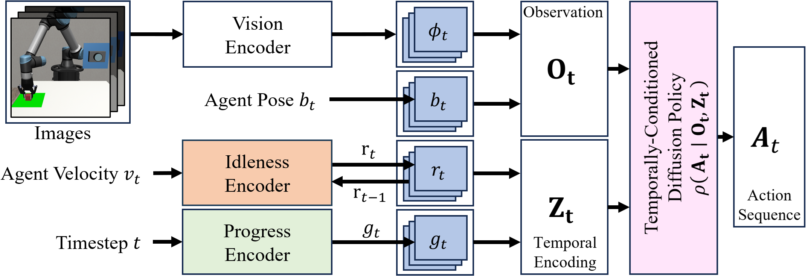
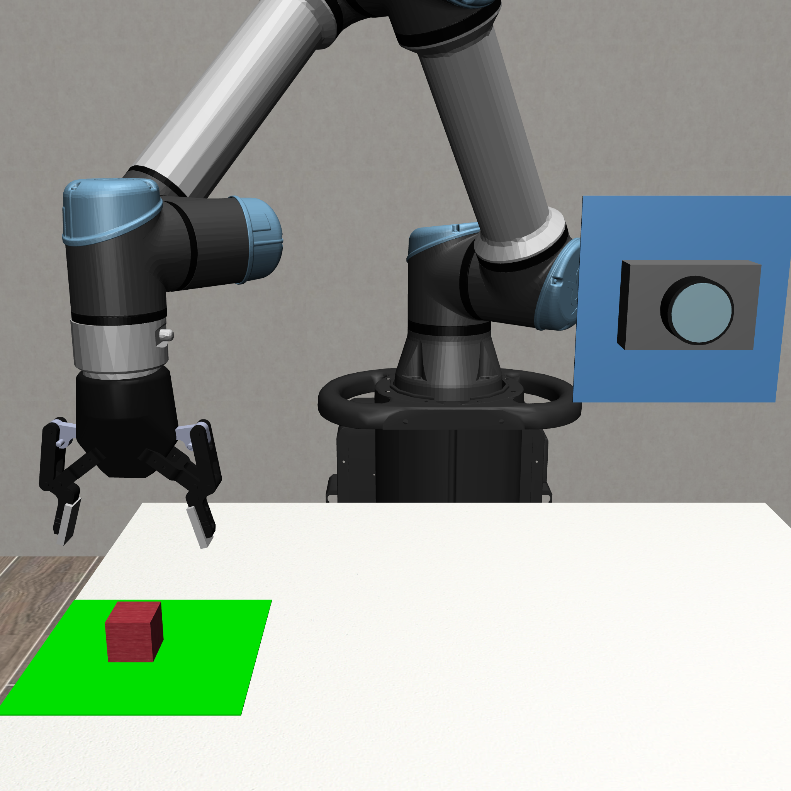
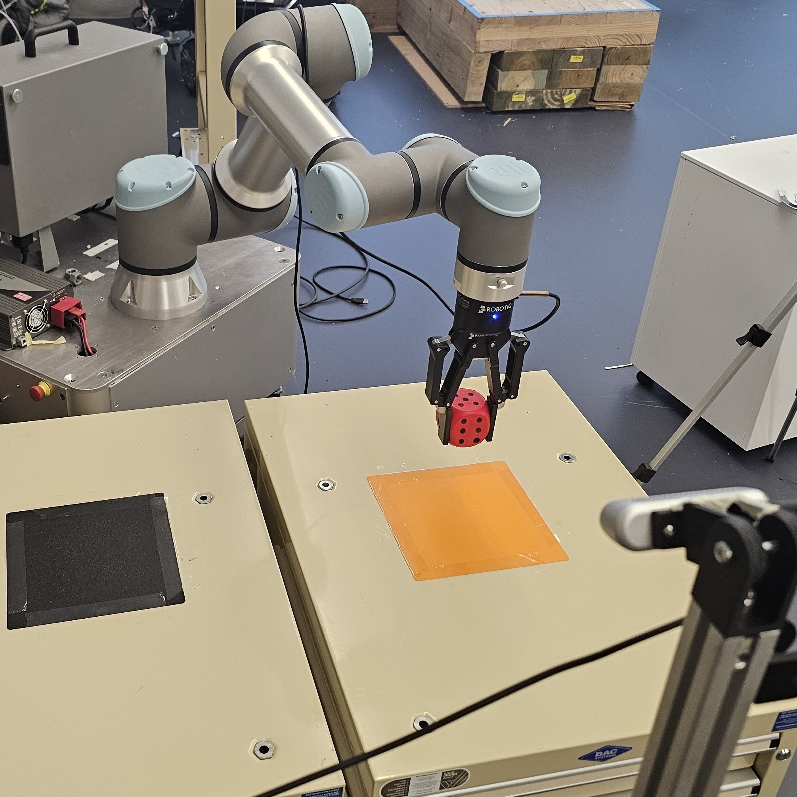

# Temporal Conditioning for Diffusion-Based Robotic Imitation Learning

A diffusion policy implementation with temporal encoding mechanisms for robotic manipulation and navigation tasks. This repository implements various temporal conditioning techniques to improve policy performance on tasks requiring waiting or long-horizon temporal reasoning. Implementation of the temporal encodings can be found in `temporal_encodings.py`.



## Table of Contents

- [Installation](#installation)
- [Quick Start](#quick-start)
- [TC-DP paper reproduction](tcdp_paper/README.md)
- [Workflows](#workflows)
  - [Downloading Datasets](#downloading-datasets)
  - [Data Collection](#data-collection)
  - [Dataset Requirements](#dataset-requirements)
  - [Training](#training)
  - [Inference](#inference)
  - [Analysis](#analysis)
- [Temporal Encodings](#temporal-encodings)

---
## Installation
Tested on Ubuntu 22.04.5 LTS. Note that `libmamba` solver was used for conda.
```bash
# Create conda environment
conda create -n temporaldiffpolicy python=3.10 -y
conda activate temporaldiffpolicy

# Install a CUDA-compatible PyTorch build.
# CUDA 12.8 is required for NVIDIA RTX 5090 (sm_120) GPUs.
pip install torch==2.9.1+cu128 torchvision==0.24.1+cu128 --index-url https://download.pytorch.org/whl/cu128

# Install the project and its standard simulation/training dependencies
pip install .

# Optional integrations
pip install ".[robosuite]"      # Robosuite and SpaceMouse support
pip install ".[realworld]"      # audio and keyboard support for real hardware
```

For multi-GPU hosts, select a GPU before running training or inference:

```bash
CUDA_VISIBLE_DEVICES=0 tdp-train ...
# or
CUDA_VISIBLE_DEVICES=0 tdp-infer ...
```

Verify CUDA is available with `python -c "import torch; print(torch.cuda.is_available())"`.

---
## Quick Start

### Interactive train-and-infer workflow

Run the launcher to either train-and-evaluate a model or run the waiting-time
analysis. The training workflow selects a compatible dataset from
`data/demonstration/` (or `data/demonstrations/`) and prompts for the training
and temporal-conditioning settings. It trains with W&B enabled, reads W&B's
generated run name (for example, `red-lake-403`) from the final checkpoint,
and passes that name to `inference.py` with matching encoding settings. The
analysis workflow prompts for `WaitAtGoal`, `LiftQA`, or `LiftQA-Real`.

```bash
tdp
```

```bash
# 1. Download pre-collected demonstration data (or collect your own)
./scripts/download_quickstart_demo_dataset.sh
./scripts/unzip_datasets.sh

# 2. Train a model with temporal encodings
tdp-train \
--dataset_path data/demonstration/wait_at_goal_dataset_v4.zarr \
--override_checkpoint_name wait_at_goal_quickstart \
--use_idleness_encoding True \
--use_sinusoidal_progress_encoding True \
--use_wandb False

# 3. Run inference
tdp-infer \
--checkpoint_path data/checkpoints/wait_at_goal_quickstart \
--use_idleness_encoding True \
--use_sinusoidal_progress_encoding True \
--num_episodes 200

# 4. Explore this run's results
tdp-analyze-waittime
```

To reproduce the paper's three-seed comparison, follow the
[TC-DP paper guide](tcdp_paper/README.md).
---
## Workflows

### Downloading Datasets

Pre-collected demonstrations, selected checkpoints and inference results are
available on [Hugging Face](https://huggingface.co/datasets/erdrsvhr9/temporally_conditioned_diffusion_policy).
See the [TC-DP paper guide](tcdp_paper/README.md) for the current paper selection,
download and upload commands, and image formats.

**Dataset Structure**:
```
data/
├── demonstration/                             # Human teleoperation demonstrations
│   ├── wait_at_goal_dataset_v4.zarr
│   ├── lift_qa_realenv_v1.zarr
│   └── lift_qa_v2.zarr
│
├── checkpoints/                               # Pre-trained model checkpoints
│   └── [various experimental configurations]
│
├── inference/                                 # Inference/evaluation results
│   └── [generated rollout datasets]
│
└── inference_extended/                        # Ablation results
    └── [generated rollout datasets]
```

**Available Demonstration Datasets**:
- `wait_at_goal_dataset_v4.zarr`: Navigation task with waiting requirement (200 episodes)
- `lift_qa_v2.zarr`: Visual quality assurance inspection manipulation task (203 episodes)
- `lift_qa_realenv_v1.zarr`: Visual quality assurance inspection manipulation task - real world (51 episodes)

---

### Data Collection

There are two types of data collection depending on your environment:

#### WaitAtGoal: Warehouse Pickup and Delivery 
A 2D navigation environments built on pygame:
<p align="center">

</p>

```bash
tdp-collect-pygame \
    --env_name WaitAtGoal \
    --output data/demonstration/my_wait_at_goal_dataset.zarr \
    --render_size 144 \
    --control_hz 10 \
    --episodes 200 \
    --seed 0
```

**Control**: Use mouse for teleoperation.


#### LiftQA: Robotic Visual Quality Inspection
A robotic manipulation task built on [Robosuite](https://github.com/ARISE-Initiative/robosuite):
<p align="center">

</p>

```bash
# first run spacemouse server 
python -m temporal_diffusion_policy.envs.robosuite.spacemouse_udp_server

# then start data collection
tdp-collect-robosuite \
    --dataset_path data/demonstration/lift_qa_v2.zarr \
    --episodes 200 \
    --control_hz 10 \
    --constrain_motion True \
    --realtime True \
    --realtime_speed 2.0 \
    --seed 0
```

**Control**: Requires SpaceMouse 3D controller (via UDP client - see `envs/robot/spacemouse_udp_server.py` and `envs/robot/spacemouse_udp_client.py`).

**Key Parameters**:
- `constrain_motion`: Limits motion to horizontal plane
- `realtime_speed`: Speed multiplier (2.0 = 2x faster than real-time to speed up data collection)

#### LiftQA-Real: Robotic Visual Quality Inspection (Real World)
A real life robotic manipulation task using a UR10e and Robotiq 2F-85 gripper.
<p align="center">

</p>

```bash
# then start data collection
tdp-collect-realworld \
    --dataset_path data/demonstration/lift_qa_realenv_2.zarr \
    --episodes 200
```
---

### Dataset Requirements
Collecting data using one of the `data_collection_x.py` scripts will ensure the correct dataset format. If you wish to bring your own zarr dataset, ensure the following features exist. Assume N is number of total steps in the dataset. 

- `episode_ends` in `root['meta']` - created automatically by `replay_buffer.py`
- `agent_pose`: *(N, D)* - D is pose dimension (env dependent)
- `full_image`: *(N,3,H,W)* - 3 for channels, H,W for height and width
- `agent_velocity`: *(N,)* if idleness encoding is used
- `step_count`: *(N,)*
- `action`: *(N,  D)* - D is action dimension (env dependent)
- `reward`: *(N,)*
- `done`: *(N,)*
- `wait_time`: *(N,)* - (optional) - nice to have for analysis
- `wait_times_each_visit`*(N,6)* - (optional) - 6 is max goal visits. nice to have for analysis


---
### Training

Train a diffusion policy model with optional temporal encodings:

```bash
tdp-train \
    --dataset_path data/demonstration/wait_at_goal_dataset_v4.zarr \
    --batch_size 512 \
    --num_epochs 200 \
    --lr 1e-4 \
    --pred_horizon 16 \
    --obs_horizon 2 \
    --action_horizon 8 \
    --use_wandb True
```

Batch size 512 with default horizon parameters has been tested on an Nvidia 5090.

**With Temporal Encodings**:

```bash
# Idleness Encoding (ID)
tdp-train \
    --dataset_path <path> \
    --use_idleness_encoding True

# Saturating Progress Encoding (SaP)
tdp-train \
    --dataset_path <path> \
    --use_saturating_progress_encoding True

# Sinusoidal Progress Encoding (SiP)
tdp-train \
    --dataset_path <path> \
    --use_sinusoidal_progress_encoding True \
    --sinusoidal_progress_encoding_dim 32

# ID + SaP
tdp-train \
    --dataset_path <path> \
    --use_idleness_encoding True \
    --use_saturating_progress_encoding True

# ID + SiP
tdp-train \
    --dataset_path <path> \
    --use_idleness_encoding True \
    --use_sinusoidal_progress_encoding True \
    --sinusoidal_progress_encoding_dim 32

```

**Checkpoints**: Saved to `data/checkpoints/<timestamp>/` with configuration and statistics.

---

### Inference

Run inference/evaluation with a trained model:

```bash
# Note: change env_name to 'LiftQA' for manipulation task
# Diffusion Policy baseline
tdp-infer \
    --checkpoint_path <path> \
    --env_name WaitAtGoal

# Idleness Encoding (ID)
tdp-infer \
    --checkpoint_path <path> \
    --env_name WaitAtGoal \
    --use_idleness_encoding True

# Saturating Progress Encoding (SaP)
tdp-infer \
    --checkpoint_path <path> \
    --env_name WaitAtGoal \
    --use_saturating_progress_encoding True

# Sinusoidal Progress Encoding (SiP)
# important note: encoding_dim must match the trained checkpoint
tdp-infer \
    --checkpoint_path <path> \
    --env_name WaitAtGoal \
    --use_sinusoidal_progress_encoding True \
    --sinusoidal_progress_encoding_dim 32

# ID + SaP
tdp-infer \
    --checkpoint_path <path> \
    --env_name WaitAtGoal \
    --use_idleness_encoding True \
    --use_saturating_progress_encoding True

# ID + SiP
# important note: encoding_dim must match the trained checkpoint
tdp-infer \
    --checkpoint_path <path> \
    --env_name WaitAtGoal \
    --use_idleness_encoding True \
    --use_sinusoidal_progress_encoding True \
    --sinusoidal_progress_encoding_dim 32
```


**With Pause-Induced Perturbation (PIP)**:
PIP is an inference-time technique.

```bash
# Note: change env_name to 'LiftQA' for manipulation task
tdp-infer \
    --checkpoint_path <path> \
    --env_name WaitAtGoal \
    --use_pause_induced_perturbation True \
    --pip_sigma 0.99 \
    --pip_window_size 20 \
    --pip_epsilon 0.03
```

**Output**: Inference results saved to `data/inference/<env>_<checkpoint>_<config>.zarr`

---

### Analysis

Analyze waiting behavior and generate plots/tables from inference datasets:

```bash
tdp-analyze-waittime
```

The script analyzes predefined dataset configurations (baseline, main experiments, extended experiments) and generates:

- **Wait time distributions**: Histograms and density plots
- **Success rate tables**: LaTeX tables with statistical metrics
- **Wasserstein distances**: Quantitative comparison to demonstration data
- **Episode metrics**: Success rates, wait times, trajectory analysis

**Customization**: Edit the `analysis/study_*.json` files, or use “Edit analysis
study configuration” in the Experiment CLI. Each file represents one
environment/study combination and lists its dataset runs.

**Output**: Plots and tables are saved to `outputs/analysis/waittime/`.

For the paper's three-seed tables and figures, real-world success criterion and
appendix ablation table, see the [TC-DP paper guide](tcdp_paper/README.md).

---

## Citation

If you use this code in your research, please cite:

```bibtex
@article{xxxxx,
  title={Temporal Conditioning for Diffusion-Based Robotic Imitation Learning},
  author={XXXX},
  journal={XXXX},
  year={2026}
}
```

---

## Acknowledgments

- Built using elements from [Diffusion Policy](https://github.com/real-stanford/diffusion_policy).
- PIP baseline implemented from [Chen et al., 2025](https://arxiv.org/pdf/2508.15669) paper.
